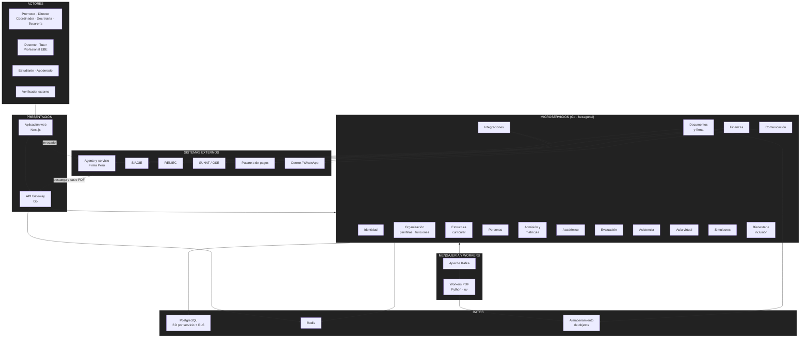

# Arquitectura inicial del sistema

## Diagrama de arquitectura

## Descripción

La arquitectura inicial se organiza en cinco bloques:

- **Presentación:** la aplicación web en Next.js (organizada por _features_) y el **API Gateway** en Go, única puerta de entrada. El gateway autentica, identifica la institución por el subdominio y el token, verifica que la función solicitada esté activa en el servicio educativo y enruta al microservicio.
- **Microservicios:** cada módulo funcional es un servicio Go independiente con arquitectura hexagonal y su propia base de datos lógica. El servicio **Organización** es el dueño de las plantillas, funciones activas y etiquetas que hacen que los módulos se adecuen a cada tipo de institución.
- **Mensajería y workers:** Kafka transporta los eventos de negocio entre servicios y los trabajos de generación de PDF. Los **workers Python** (gestionados con `uv`) consumen esos trabajos, generan el PDF y lo guardan en el almacenamiento de objetos.
- **Datos:** PostgreSQL con una base lógica por servicio y RLS por `institution_id`; Redis para caché, sesiones, límites de peticiones y avance de procesos; almacenamiento de objetos compatible con S3 para los PDF y adjuntos.
- **Sistemas externos:** el **agente Firma Perú** firma los documentos en la computadora del firmante; SIAGIE, RENIEC, SUNAT (vía OSE), la pasarela de pagos y los proveedores de correo y WhatsApp se integran mediante adaptadores.

## Flujo principal: emisión de un certificado firmado

```mermaid
flowchart LR
    A["Secretaría solicita<br/>certificados"] --> B["Documentos registra la<br/>solicitud y publica trabajos"]
    B --> C["Kafka<br/>documents.pdf.requested"]
    C --> D["Worker Python genera PDF<br/>y lo sube al almacenamiento"]
    D --> E["Kafka<br/>documents.pdf.generated"]
    E --> F["Documentos marca<br/>'listo para firmar'"]
    F --> G["Director firma con<br/>el agente Firma Perú"]
    G --> H["Documentos guarda la versión<br/>firmada e inmutable"]
    H --> I["Kafka<br/>documents.document.signed"]
    I --> J["Comunicación avisa al<br/>estudiante / apoderado"]
```

