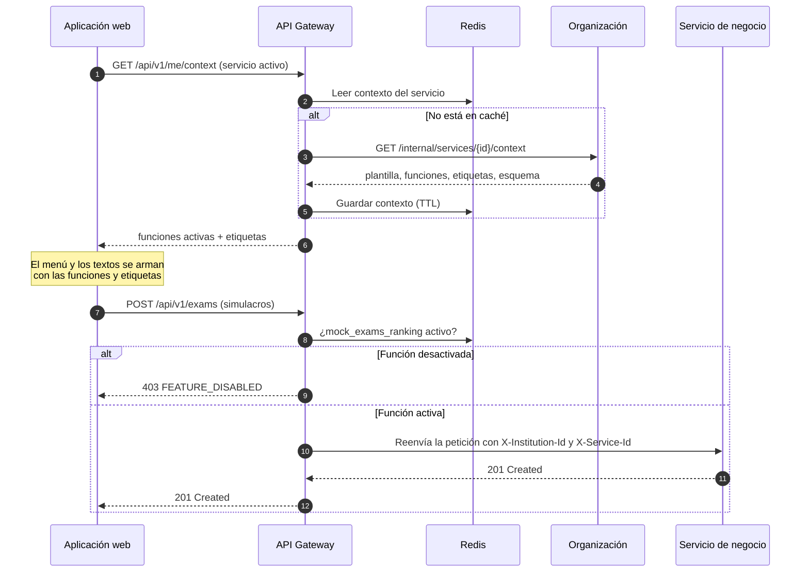

# Componentes arquitectónicos

## 1. Catálogo de microservicios

| Servicio              | Código         | Responsabilidad                                                                                           | Datos de los que es dueño    | ¿Activable?                           |
| --------------------- | -------------- | --------------------------------------------------------------------------------------------------------- | ---------------------------- | ------------------------------------- |
| API Gateway           | `gateway`      | Entrada única, autenticación, resolución de institución, verificación de funciones, límites de peticiones | Ninguno (usa Redis)          | —                                     |
| Identidad             | `identity`     | Cuentas, sesiones, 2FA, roles y permisos por institución                                                  | `iam.*`                      | No                                    |
| Organización          | `organization` | Organizaciones, servicios educativos, sedes, plantillas, funciones activas, etiquetas, suscripción        | `tenant.*`                   | No                                    |
| Estructura curricular | `curriculum`   | Catálogo MINEDU (global, solo lectura) y programas propios                                                | `curriculum.*`, `program.*`  | No                                    |
| Personas              | `people`       | Estudiantes, apoderados, personal                                                                         | `core.*`                     | No                                    |
| Admisión y matrícula  | `enrollment`   | Postulación, ubicación, matrícula por sección y por curso, traslados, retiros                             | `enrollment.*`               | Parcial                               |
| Académico             | `academic`     | Periodos, cortes, secciones, aulas, carga docente, horarios                                               | `academic.*`                 | No                                    |
| Evaluación            | `assessment`   | Esquemas de calificación, notas, cierres, situación final, actas                                          | `assessment.*`               | No                                    |
| Asistencia            | `attendance`   | Asistencia de estudiantes y personal                                                                      | `attendance.*`               | No                                    |
| Aula virtual          | `lms`          | Recursos, tareas, foros                                                                                   | `lms.*`                      | Sí (`lms`)                            |
| Simulacros            | `exams`        | Simulacros, corrección, ranking                                                                           | `exam.*`                     | Sí (`mock_exams_ranking`)             |
| Bienestar e inclusión | `wellbeing`    | Tutoría, alertas, NEE, POI, PRITE, SAANEE                                                                 | `wellbeing.*`, `inclusion.*` | Parcial (`inclusion_nee`)             |
| Finanzas              | `finance`      | Conceptos, cronogramas, cobros, becas, caja, comprobantes                                                 | `finance.*`                  | Sí (`tuition_fees`)                   |
| Comunicación          | `comms`        | Comunicados, mensajería, notificaciones por correo, WhatsApp y web                                        | `comms.*`                    | No                                    |
| Documentos            | `documents`    | Plantillas de documento, solicitudes, lotes, flujo de firma Firma Perú, verificación pública              | `documents.*`                | Firma activable (`digital_signature`) |
| Integraciones         | `integrations` | Exportación SIAGIE, consultas RENIEC                                                                      | `integration.*`              | Sí                                    |
| Worker de PDF         | `pdf-worker`   | Renderizar plantillas HTML a PDF, insertar QR, subir al almacenamiento                                    | Ninguno (sin estado)         | —                                     |

## 2. Componentes de infraestructura

| Componente                | Tecnología                                            | Uso                                                                                                                                        |
| ------------------------- | ----------------------------------------------------- | ------------------------------------------------------------------------------------------------------------------------------------------ |
| Bus de eventos            | Apache Kafka (modo KRaft)                             | Eventos de dominio y trabajos de PDF; clave de partición `institution_id` para mantener el orden por institución                           |
| Registro de esquemas      | JSON Schema versionado en el repositorio de contratos | Contrato de cada evento (`*.v1`)                                                                                                           |
| Base de datos             | PostgreSQL                                            | Una base lógica por servicio; RLS por `institution_id`; tabla `outbox` en cada servicio que publica eventos                                |
| Caché                     | Redis                                                 | Contexto de servicio (funciones y etiquetas), permisos, sesiones revocadas, límites de peticiones, claves de idempotencia, avance de lotes |
| Almacenamiento de objetos | Compatible con S3 (MinIO en desarrollo)               | PDF generados, PDF firmados (con versionado y bloqueo de objetos), adjuntos                                                                |
| Observabilidad            | OpenTelemetry + registros estructurados               | Trazas entre gateway, servicios, Kafka y workers; métricas de _lag_ de Kafka                                                               |

## 3. Tópicos de Kafka principales

Convención: `<dominio>.<entidad>.<evento>.v<versión>`.

| Tópico                               | Productor    | Consumidores                                              | Para qué                                        |
| ------------------------------------ | ------------ | --------------------------------------------------------- | ----------------------------------------------- |
| `tenant.service.features-changed.v1` | Organización | Gateway, todos los servicios                              | Invalidar la caché del contexto del servicio    |
| `people.student.registered.v1`       | Personas     | Matrícula, Finanzas, Comunicación                         | Copia local mínima del estudiante               |
| `enrollment.enrollment.created.v1`   | Matrícula    | Académico, Evaluación, Asistencia, Finanzas, Aula virtual | Agregar al estudiante a nóminas, generar cargos |
| `enrollment.enrollment.withdrawn.v1` | Matrícula    | Evaluación, Finanzas, Asistencia                          | Retiro del estudiante                           |
| `assessment.term.closed.v1`          | Evaluación   | Documentos, Bienestar, Comunicación                       | Habilitar libretas, calcular alertas            |
| `assessment.period.closed.v1`        | Evaluación   | Documentos, Integraciones                                 | Actas, certificados, exportación SIAGIE         |
| `attendance.absence.recorded.v1`     | Asistencia   | Bienestar, Comunicación                                   | Alertas por inasistencia                        |
| `finance.payment.confirmed.v1`       | Finanzas     | Matrícula, Comunicación, Documentos                       | Habilitar matrícula, emitir comprobante en PDF  |
| `documents.pdf.requested.v1`         | Documentos   | `pdf-worker`                                              | Trabajo de generación de PDF                    |
| `documents.pdf.generated.v1`         | `pdf-worker` | Documentos                                                | Resultado del trabajo (ruta, hash, páginas)     |
| `documents.pdf.failed.v1`            | `pdf-worker` | Documentos                                                | Error del trabajo tras agotar reintentos        |
| `documents.document.signed.v1`       | Documentos   | Comunicación, Integraciones                               | Avisar que el documento está disponible         |

## 4. Adaptación de módulos por tipo de institución

## 5. Reglas entre componentes

| #   | Regla                                                                                                  | Motivo                                         |
| --- | ------------------------------------------------------------------------------------------------------ | ---------------------------------------------- |
| 1   | Solo el gateway está expuesto a Internet; los servicios están en una red interna                       | Un único punto de control de seguridad         |
| 2   | Un servicio no lee ni escribe la base de datos de otro                                                 | Cada servicio es dueño de sus datos            |
| 3   | Si un servicio necesita datos de otro con frecuencia, mantiene una copia mínima alimentada por eventos | Reduce el acoplamiento síncrono                |
| 4   | Todo evento se publica a través de la tabla `outbox` en la misma transacción                           | No se pierden ni se inventan eventos           |
| 5   | Todo consumidor es idempotente (guarda el `event_id` procesado)                                        | Kafka puede entregar un mensaje más de una vez |
| 6   | Toda petición y evento lleva `institution_id`, `service_id` y `correlation_id`                         | Aislamiento y trazabilidad                     |
| 7   | Ningún código pregunta por el tipo de institución; pregunta por funciones activas                      | Adaptabilidad sin programar                    |
