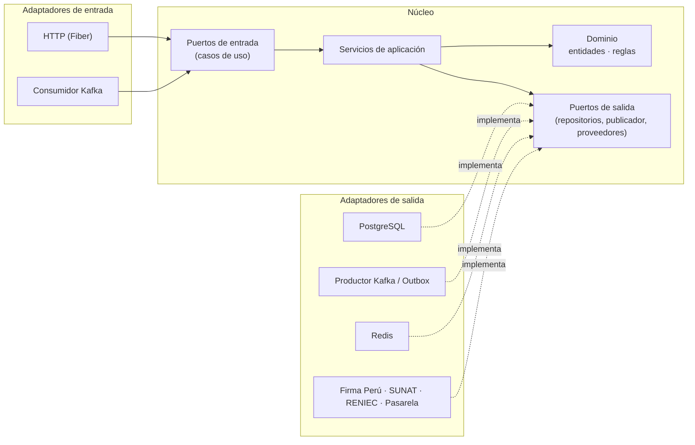
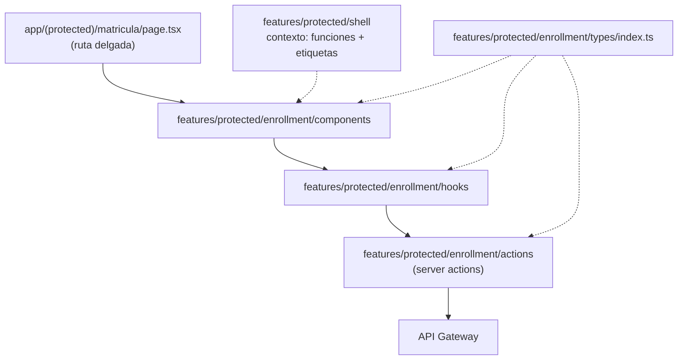

# Enfoque arquitectónico

Se utilizan dos enfoques, uno para el backend y otro para el frontend.

## 1. Backend: arquitectura hexagonal (puertos y adaptadores)

| Elemento                        | Descripción aplicada a Stella Education                                                                                                                                                                                                                                         |
| ------------------------------- | ------------------------------------------------------------------------------------------------------------------------------------------------------------------------------------------------------------------------------------------------------------------------------- |
| Patrón / enfoque arquitectónico | Arquitectura hexagonal (puertos y adaptadores), en cada microservicio Go y en los workers Python.                                                                                                                                                                               |
| Objetivo                        | Que el dominio y los casos de uso no conozcan HTTP, Kafka, PostgreSQL, Redis, Firma Perú ni ningún proveedor.                                                                                                                                                                   |
| ¿Qué problema resuelve?         | Evita que un cambio de tecnología (otra pasarela, otro OSE, otro motor de PDF, otra versión de Firma Perú) obligue a reescribir las reglas de negocio. Permite probar el negocio sin infraestructura.                                                                           |
| Partes definidas                | **Dominio** (entidades y reglas), **Puertos** (interfaces de entrada y salida), **Servicios de aplicación** (casos de uso), **Adaptadores de entrada** (HTTP, consumidores Kafka) y **Adaptadores de salida** (PostgreSQL, Kafka, Redis, almacenamiento, proveedores externos). |
| Regla de dependencia            | Los adaptadores dependen del núcleo; el núcleo nunca importa adaptadores.                                                                                                                                                                                                       |
| Beneficios                      | • Pruebas unitarias del negocio con adaptadores en memoria. • Cambiar un proveedor = escribir un adaptador. • Todos los servicios tienen la misma forma, lo que facilita moverse entre ellos.                                                                             |

## 2. Frontend: features architecture

| Elemento                           | Descripción aplicada a Stella Education                                                                                                                                                                                       |
| ---------------------------------- | ----------------------------------------------------------------------------------------------------------------------------------------------------------------------------------------------------------------------------- |
| Patrón / enfoque arquitectónico    | Arquitectura por _features_ sobre Next.js (App Router), sin carpeta `src/`.                                                                                                                                                   |
| Objetivo                           | Que cada módulo funcional (matrícula, evaluación, documentos…) tenga todo su código frontend en un solo lugar, igual que su microservicio en el backend.                                                                      |
| ¿Qué problema resuelve?            | Evita carpetas globales gigantes (`components/`, `hooks/`, `services/`) donde se mezclan módulos, y facilita activar u ocultar un módulo completo según la plantilla del servicio.                                            |
| Partes definidas                   | `app/`: solo rutas y _layouts_, delgados. `features/<área>/<módulo>/`: `components/`, `hooks/`, `actions/`, `types/index.ts`. `components/ui/` y `lib/`: piezas compartidas sin lógica de negocio.                      |
| Reglas                             | • Una acción (_server action_) por endpoint. • Un hook por acción; el hook prepara datos, maneja errores y estado. • Los componentes solo muestran y llaman hooks. • Todos los tipos del módulo en `types/index.ts`. |
| Adaptación por tipo de institución | El _layout_ protegido carga el **contexto del servicio** (funciones activas y etiquetas). El menú se arma desde un registro de módulos filtrado por `feature_code`, y los textos salen de `useLabels()`.                      |
| Beneficios                         | • Un módulo se puede quitar u ocultar sin tocar otros. • Responsabilidades claras entre componente, hook y acción. • Correspondencia directa con los microservicios.                                                    |

