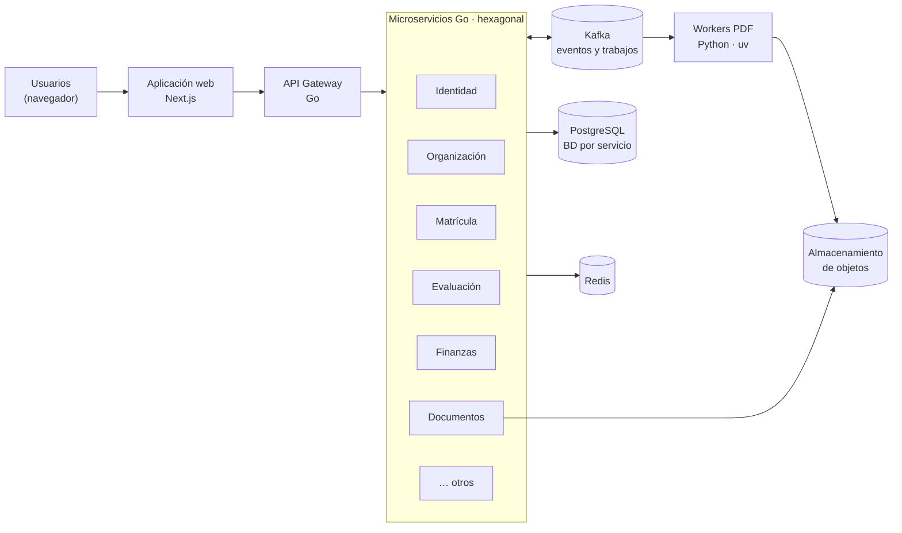

# Estilo arquitectónico

Se utiliza el estilo arquitectónico **microservicios + orientado a eventos**.

| Elemento                         | Descripción aplicada a Stella Education                                                                                                                                                                                            |
| -------------------------------- | ---------------------------------------------------------------------------------------------------------------------------------------------------------------------------------------------------------------------------------- |
| Estilo principal                 | **Microservicios**: un servicio desplegable por contexto de negocio (matrícula, evaluación, finanzas, documentos…), cada uno con su propia base de datos lógica.                                                                   |
| Estilo complementario            | **Arquitectura orientada a eventos**: los servicios publican hechos de negocio en Kafka (`enrollment.created`, `assessment.term.closed`…) y los demás reaccionan sin acoplarse.                                                    |
| Estilo para procesos pesados     | **Cola de trabajos con workers**: la generación de PDF se encola en Kafka y la procesan workers Python independientes.                                                                                                             |
| Punto de entrada                 | **API Gateway**: única puerta pública; enruta al servicio correcto.                                                                                                                                                                |
| ¿Por qué no un monolito modular? | La plataforma atiende a muchas instituciones con picos distintos (matrícula, cierre de bimestre, emisión masiva). Con microservicios se escala solo lo que se necesita y una falla en un módulo no crítico no detiene a los demás. |
| Costo asumido                    | Mayor complejidad operativa: despliegue, observabilidad y consistencia eventual entre servicios. Se mitiga con contenedores, trazas distribuidas y el patrón Outbox.                                                               |

## Vista general

## Tipos de comunicación

| Comunicación                   | Mecanismo                           | Cuándo se usa                                                                 |
| ------------------------------ | ----------------------------------- | ----------------------------------------------------------------------------- |
| Navegador → Aplicación web     | HTTPS                               | Siempre                                                                       |
| Aplicación web → API Gateway   | HTTPS / REST / JSON                 | Toda operación del usuario                                                    |
| API Gateway → Servicios        | HTTP / REST interno                 | Peticiones síncronas del usuario                                              |
| Servicio → Servicio (consulta) | HTTP / REST interno                 | Solo cuando se necesita una respuesta inmediata y no hay copia local del dato |
| Servicio → Servicio (hechos)   | Eventos en Kafka                    | Cambios de estado que otros deben conocer                                     |
| Servicio Documentos → Workers  | Trabajos en Kafka                   | Generación de PDF                                                             |
| Navegador → Agente Firma Perú  | Invocador JavaScript → agente local | Firma digital de documentos                                                   |
