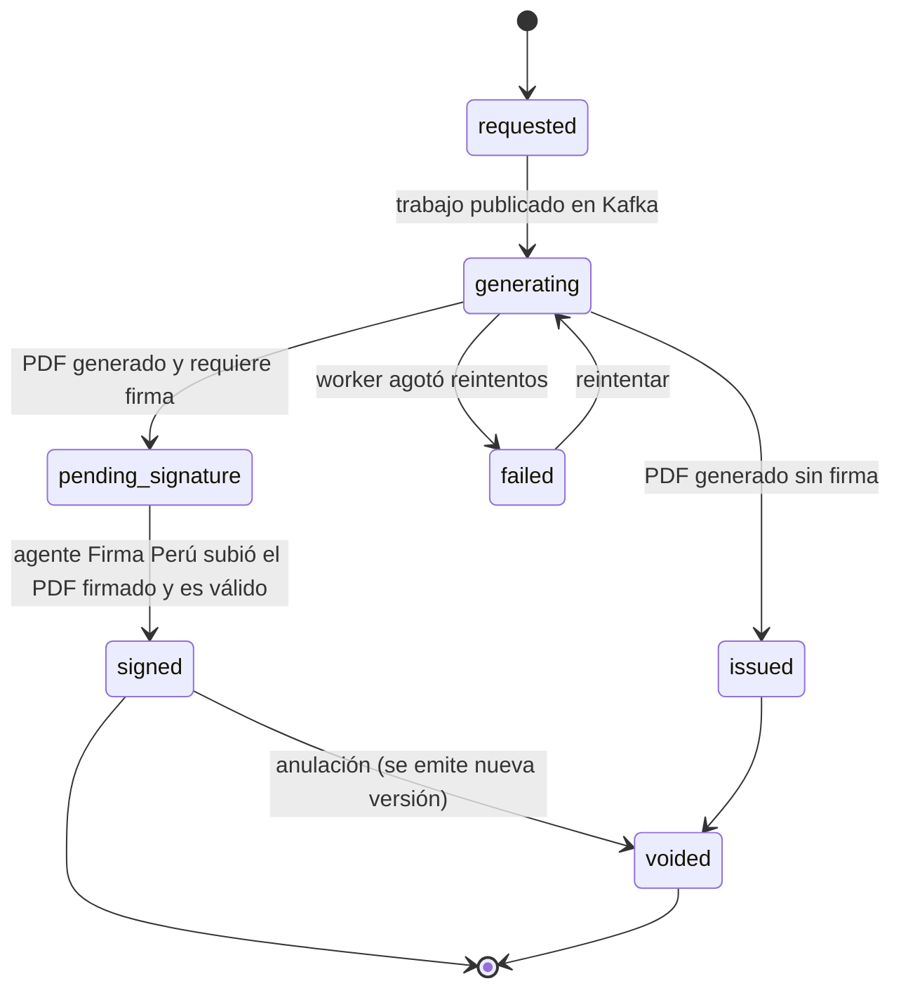
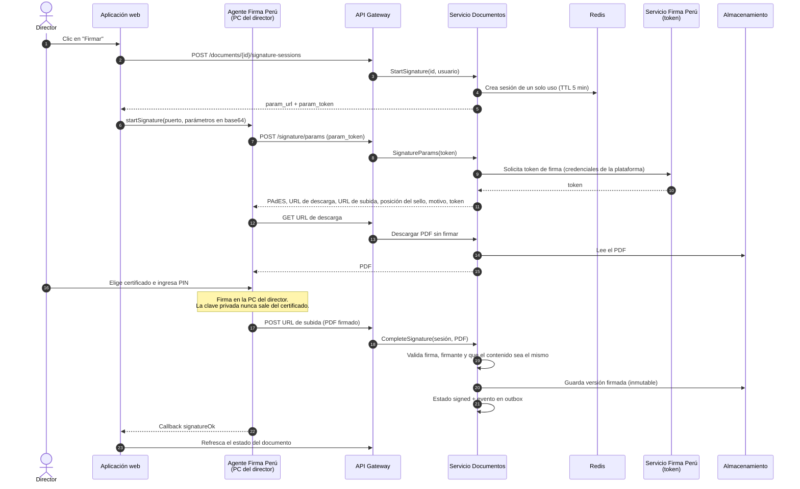

# Diseño interno de módulos

> **Proyecto:** Stella Education · **Módulo de referencia:** Documentos (emisión de PDF y firma con Firma Perú)
> **Backend:** Go (Fiber) · **Workers:** Python con uv · **Frontend:** Next.js
> **Enfoque:** arquitectura hexagonal en backend y workers; _features architecture_ en frontend
> **Nivel C4:** 4 – Código · **Versión:** 1.0

---

## 1. Propósito

Este documento describe **cómo se organiza el código por dentro** de un microservicio Go, de un worker Python y de un módulo del frontend. Tiene tres objetivos:

- que todos los servicios y módulos se construyan con la misma estructura;
- que las reglas de negocio queden aisladas de la tecnología (HTTP, Kafka, PostgreSQL, Redis, Firma Perú);
- que cualquier integrante del equipo sepa dónde va cada archivo y de qué puede depender.

Se toma como referencia el módulo **Documentos**, porque es el que usa todo el stack: Go, Kafka, Redis, PostgreSQL, el worker Python, el almacenamiento de objetos y el agente Firma Perú.

---

## 2. Organización del repositorio

```text
stella-education/
├── apps/
│   └── web/                      Aplicación Next.js (features architecture)
├── services/                     Microservicios Go (uno por carpeta, mismo esqueleto)
│   ├── gateway/
│   ├── identity/
│   ├── organization/
│   ├── enrollment/
│   ├── assessment/
│   ├── finance/
│   ├── documents/
│   └── …
├── workers/
│   └── pdf-worker/               Worker Python gestionado con uv
├── contracts/
│   ├── openapi/                  Contratos REST de cada servicio
│   └── events/                   JSON Schema de cada evento de Kafka (*.v1.json)
├── deploy/
│   └── compose.yml               PostgreSQL, Redis, Kafka, MinIO para desarrollo
└── docs/
```

---

## 3. Microservicio Go con arquitectura hexagonal

### 3.1 Estructura de carpetas (servicio `documents`)

```text
services/documents/
├── cmd/
│   └── server/
│       └── main.go                         Raíz de composición: crea adaptadores e inyecta
├── internal/
│   ├── config/
│   │   └── config.go                       Variables de entorno
│   ├── core/
│   │   ├── domain/
│   │   │   ├── document.go                 Entidad Document y sus transiciones de estado
│   │   │   ├── document_status.go          Estados del documento
│   │   │   ├── document_type.go            Libreta, constancia, acta, certificado…
│   │   │   ├── batch.go                    Lote de documentos y su avance
│   │   │   ├── signature.go                Objeto de valor SignatureRecord
│   │   │   └── errors.go                   Errores de dominio
│   │   ├── port/
│   │   │   ├── inbound.go                  Interfaces de los casos de uso
│   │   │   ├── document_repository.go      Persistencia de documentos y lotes
│   │   │   ├── event_publisher.go          Publicar eventos (vía outbox)
│   │   │   ├── file_storage.go             Guardar y leer PDF
│   │   │   ├── document_data_source.go     Obtener los datos del documento (notas, matrícula)
│   │   │   ├── service_context.go          Funciones activas y etiquetas del servicio
│   │   │   ├── signature_provider.go       Firma Perú: token y parámetros de firma
│   │   │   ├── signature_session_store.go  Sesiones de firma de un solo uso
│   │   │   └── signature_validator.go      Validar el PDF firmado
│   │   └── service/
│   │       ├── request_documents.go        Caso de uso: solicitar documentos (individual o lote)
│   │       ├── handle_pdf_result.go        Caso de uso: registrar PDF generado o fallido
│   │       ├── start_signature.go          Caso de uso: abrir sesión de firma
│   │       ├── signature_params.go         Caso de uso: entregar parámetros al agente
│   │       ├── complete_signature.go       Caso de uso: recibir y validar el PDF firmado
│   │       └── verify_document.go          Caso de uso: verificación pública por QR
│   └── adapter/
│       ├── inbound/
│       │   ├── http/
│       │   │   ├── router.go               Rutas /api/v1/documents, /api/v1/signature, /verify
│       │   │   ├── document_handler.go
│       │   │   ├── signature_handler.go    Endpoints que llama el agente Firma Perú
│       │   │   └── verify_handler.go
│       │   └── kafka/
│       │       └── pdf_result_consumer.go  Consume documents.pdf.generated / failed
│       └── outbound/
│           ├── postgres/
│           │   ├── document_repository.go  Implementa DocumentRepository (con RLS)
│           │   ├── outbox_publisher.go     Implementa EventPublisher escribiendo en outbox
│           │   └── tx.go                   Unidad de trabajo y SET app.institution_id
│           ├── kafka/
│           │   └── outbox_relay.go         Lee outbox y publica en Kafka
│           ├── redisclient/
│           │   ├── signature_session_store.go
│           │   └── batch_progress.go
│           ├── storage/
│           │   └── s3_storage.go           Implementa FileStorage (compatible con S3)
│           ├── firmaperu/
│           │   └── client.go               Implementa SignatureProvider
│           ├── pades/
│           │   └── validator.go            Implementa SignatureValidator
│           └── services/
│               ├── assessment_client.go    Implementa DocumentDataSource (HTTP interno)
│               └── organization_client.go  Implementa ServiceContext (Redis + HTTP)
├── migrations/
│   └── 0001_documents.sql
├── Dockerfile
└── go.mod
```

### 3.2 Qué contiene cada parte

| Carpeta              | Capa hexagonal       | Responsabilidad                                                                                        | Puede importar                                 |
| -------------------- | -------------------- | ------------------------------------------------------------------------------------------------------ | ---------------------------------------------- |
| `core/domain`        | Dominio              | Entidades, objetos de valor y reglas (por ejemplo: un documento firmado no se modifica)                | Solo la librería estándar                      |
| `core/port`          | Puertos              | Interfaces de entrada (casos de uso) y de salida (repositorio, publicador, almacenamiento, Firma Perú) | `core/domain`                                  |
| `core/service`       | Aplicación           | Implementa los casos de uso coordinando dominio y puertos                                              | `core/domain`, `core/port`                     |
| `adapter/inbound`    | Adaptador de entrada | Traduce HTTP o mensajes de Kafka a llamadas a los casos de uso                                         | `core/port`                                    |
| `adapter/outbound`   | Adaptador de salida  | Implementa los puertos con una tecnología concreta                                                     | `core/port`, `core/domain`, librerías externas |
| `cmd/server/main.go` | Composición          | Crea las implementaciones concretas y las conecta                                                      | Todo                                           |

> **Regla de dependencia:** `core/` nunca importa nada de `adapter/`. Se verifica en CI con una regla de importaciones (por ejemplo, `depguard` en `golangci-lint`).

### 3.3 Dominio: entidad `Document`

```go
// internal/core/domain/document_status.go
type DocumentStatus string

const (
    StatusRequested        DocumentStatus = "requested"
    StatusGenerating       DocumentStatus = "generating"
    StatusPendingSignature DocumentStatus = "pending_signature"
    StatusSigned           DocumentStatus = "signed"
    StatusIssued           DocumentStatus = "issued" // sin firma digital
    StatusFailed           DocumentStatus = "failed"
    StatusVoided           DocumentStatus = "voided"
)
```

```go
// internal/core/domain/document.go
type Document struct {
    ID                string
    InstitutionID     string
    ServiceID         string
    Type              DocumentType
    SubjectID         string // estudiante al que pertenece
    Status            DocumentStatus
    RequiresSignature bool
    VerificationCode  string
    UnsignedFile      *StoredFile
    SignedFile        *StoredFile
    Signature         *SignatureRecord
    Version           int
}

func (d *Document) MarkGenerated(file StoredFile) error {
    if d.Status != StatusGenerating {
        return ErrInvalidTransition
    }
    d.UnsignedFile = &file
    if d.RequiresSignature {
        d.Status = StatusPendingSignature
    } else {
        d.Status = StatusIssued
    }
    return nil
}

func (d *Document) MarkSigned(file StoredFile, sig SignatureRecord) error {
    if d.Status != StatusPendingSignature {
        return ErrInvalidTransition
    }
    d.SignedFile, d.Signature, d.Status = &file, &sig, StatusSigned
    return nil
}
```



### 3.4 Puertos

```go
// internal/core/port/inbound.go
type RequestDocumentsUseCase interface {
    Execute(ctx context.Context, cmd RequestDocumentsCommand) (BatchID string, err error)
}

type CompleteSignatureUseCase interface {
    Execute(ctx context.Context, sessionID string, signedPDF io.Reader) error
}

// internal/core/port/signature_provider.go
type SignatureProvider interface {
    IssueToken(ctx context.Context) (string, error)
    BuildParams(ctx context.Context, in SignatureParamsInput) (SignatureParams, error)
}

// internal/core/port/file_storage.go
type FileStorage interface {
    Put(ctx context.Context, key string, r io.Reader, opts PutOptions) (domain.StoredFile, error)
    PresignGet(ctx context.Context, key string, ttl time.Duration) (string, error)
}
```

### 3.5 Caso de uso: solicitar documentos

```go
// internal/core/service/request_documents.go
type RequestDocumentsService struct {
    repo     port.DocumentRepository
    data     port.DocumentDataSource
    context  port.ServiceContext
    events   port.EventPublisher
    tx       port.UnitOfWork
}

func (s *RequestDocumentsService) Execute(ctx context.Context, cmd port.RequestDocumentsCommand) (string, error) {
    svc, err := s.context.Get(ctx, cmd.ServiceID) // funciones activas, etiquetas, esquema
    if err != nil {
        return "", err
    }
    batch := domain.NewBatch(cmd.InstitutionID, cmd.ServiceID, cmd.Type, len(cmd.SubjectIDs))

    return batch.ID, s.tx.Do(ctx, func(ctx context.Context) error {
        if err := s.repo.SaveBatch(ctx, batch); err != nil {
            return err
        }
        for _, subjectID := range cmd.SubjectIDs {
            payload, err := s.data.Snapshot(ctx, cmd.Type, subjectID, cmd.PeriodID)
            if err != nil {
                return err
            }
            doc := domain.NewDocument(batch, subjectID, svc.HasFeature("digital_signature"))
            doc.StartGenerating()
            if err := s.repo.Save(ctx, doc); err != nil {
                return err
            }
            // Se escribe en la tabla outbox en la misma transacción
            if err := s.events.Publish(ctx, event.PdfRequested(doc, svc.Labels, svc.TemplateFor(cmd.Type), payload)); err != nil {
                return err
            }
        }
        return nil
    })
}
```

| Paso | Qué hace                                                              | Puerto usado              |
| ---- | --------------------------------------------------------------------- | ------------------------- |
| 1    | Lee las funciones, etiquetas y la plantilla de documento del servicio | `ServiceContext`          |
| 2    | Crea el lote                                                          | `DocumentRepository`      |
| 3    | Toma una "foto" (_snapshot_) de los datos del documento               | `DocumentDataSource`      |
| 4    | Crea cada documento indicando si requiere firma (`digital_signature`) | Dominio                   |
| 5    | Encola el trabajo de PDF en la misma transacción                      | `EventPublisher` (outbox) |

> **Por qué una foto de los datos:** el worker no consulta bases de datos. Todo lo que necesita (notas, etiquetas, datos del estudiante, logo) viaja en el trabajo, así el PDF refleja exactamente los datos del momento de la solicitud.

### 3.6 Multiinstitución en PostgreSQL

Cada transacción fija la institución antes de ejecutar consultas, y las políticas RLS filtran por ella:

```sql
-- migrations/0001_documents.sql (extracto)
CREATE TABLE documents.document (
    id                uuid PRIMARY KEY,
    institution_id    uuid NOT NULL,
    service_id        uuid NOT NULL,
    type              text NOT NULL,
    status            text NOT NULL CHECK (status IN ('requested','generating','pending_signature',
                                                      'signed','issued','failed','voided')),
    verification_code text NOT NULL UNIQUE,
    unsigned_key      text,
    unsigned_sha256   text,
    signed_key        text,
    signed_sha256     text,
    signer_dni        text,
    signed_at         timestamptz,
    version           int  NOT NULL DEFAULT 1
);

ALTER TABLE documents.document ENABLE ROW LEVEL SECURITY;
CREATE POLICY tenant_isolation ON documents.document
    USING (institution_id = current_setting('app.institution_id')::uuid);
```

```go
// internal/adapter/outbound/postgres/tx.go
func (u *UnitOfWork) Do(ctx context.Context, fn func(context.Context) error) error {
    return pgx.BeginFunc(ctx, u.pool, func(tx pgx.Tx) error {
        if _, err := tx.Exec(ctx, "SELECT set_config('app.institution_id', $1, true)", tenant.From(ctx)); err != nil {
            return err
        }
        return fn(withTx(ctx, tx))
    })
}
```

---

## 4. Worker Python con uv

### 4.1 Estructura de carpetas

```text
workers/pdf-worker/
├── pyproject.toml                 Dependencias y configuración (uv)
├── uv.lock                        Versiones exactas (se versiona en Git)
├── .python-version                Versión de Python fijada por uv
├── Dockerfile
├── src/
│   └── pdf_worker/
│       ├── __main__.py            Raíz de composición: crea adaptadores y arranca el consumidor
│       ├── config.py
│       ├── domain/
│       │   ├── job.py             PdfJob: tipo, plantilla, etiquetas, datos, firma requerida
│       │   ├── result.py          PdfResult: ruta, sha256, páginas, caja de firma
│       │   └── errors.py          Errores recuperables y no recuperables
│       ├── application/
│       │   └── generate_pdf.py    Caso de uso GeneratePdf
│       ├── ports/
│       │   ├── renderer.py        Protocol: render(template, context) -> bytes
│       │   ├── storage.py         Protocol: put(key, data) -> StoredFile
│       │   ├── publisher.py       Protocol: published(result) / failed(job, error)
│       │   └── qr.py              Protocol: make(url) -> bytes
│       └── adapters/
│           ├── kafka_consumer.py  Consume documents.pdf.requested (confluent-kafka)
│           ├── kafka_publisher.py Publica documents.pdf.generated / failed
│           ├── weasyprint_renderer.py  Jinja2 + WeasyPrint (HTML → PDF)
│           ├── segno_qr.py        Código QR de verificación
│           └── s3_storage.py      boto3 contra almacenamiento compatible con S3
├── templates/
│   ├── report_card/
│   │   ├── competency/            Libreta por competencias (colegio, CEBA)
│   │   ├── numeric/               Libreta vigesimal (CETPRO, instituto)
│   │   ├── descriptive/           Informe descriptivo (CEBE, PRITE, Inicial)
│   │   └── score/                 Reporte de puntajes (academia)
│   ├── certificate/
│   ├── enrollment_record/         Constancia de matrícula
│   └── _base/                     Cabecera, pie, estilos y caja de firma comunes
└── tests/
```

### 4.2 Gestión con uv

| Tarea                                 | Comando                                                                                                     |
| ------------------------------------- | ----------------------------------------------------------------------------------------------------------- |
| Crear entorno e instalar dependencias | `uv sync`                                                                                                   |
| Agregar una dependencia               | `uv add weasyprint`                                                                                         |
| Ejecutar el worker                    | `uv run python -m pdf_worker`                                                                               |
| Ejecutar pruebas                      | `uv run pytest`                                                                                             |
| Imagen Docker                         | `uv sync --frozen --no-dev` sobre la imagen oficial de uv; solo se copia `.venv` y `src/` a la imagen final |

```toml
# pyproject.toml (extracto)
[project]
name = "pdf-worker"
requires-python = ">=3.12"
dependencies = [
    "confluent-kafka",
    "jinja2",
    "weasyprint",
    "segno",
    "boto3",
    "pydantic",
    "opentelemetry-sdk",
]

[dependency-groups]
dev = ["pytest", "ruff", "mypy"]
```

### 4.3 Caso de uso `GeneratePdf`

```python
# src/pdf_worker/application/generate_pdf.py
class GeneratePdf:
    def __init__(self, renderer: Renderer, qr: QrMaker, storage: Storage, publisher: Publisher):
        self._renderer, self._qr, self._storage, self._publisher = renderer, qr, storage, publisher

    def execute(self, job: PdfJob) -> None:
        context = {
            **job.data,
            "labels": job.labels,                       # "Grado", "Semestre", "Módulo"…
            "qr_png": self._qr.make(job.verification_url),
            "signature_box": job.requires_signature,    # reserva el espacio del sello de firma
        }
        pdf = self._renderer.render(job.template, context)
        stored = self._storage.put(job.output_key, pdf)
        self._publisher.published(PdfResult.from_job(job, stored, pdf))
```

| Regla del worker                                                                                             | Motivo                                                    |
| ------------------------------------------------------------------------------------------------------------ | --------------------------------------------------------- |
| Sin estado y sin acceso a bases de datos                                                                     | Escala agregando réplicas; todo llega en el trabajo       |
| Confirma el _offset_ de Kafka solo después de publicar el resultado                                          | Si el worker cae a mitad, el trabajo se vuelve a procesar |
| Idempotente: la ruta de salida depende del `document_id` y la versión                                        | Reprocesar no crea archivos duplicados                    |
| Errores recuperables se reintentan con espera creciente; los no recuperables van a `documents.pdf.failed.v1` | Un trabajo defectuoso no bloquea la partición             |
| La plantilla se elige por tipo de documento y esquema de calificación, no por tipo de institución            | El mismo worker sirve a todas las instituciones           |
| El PDF reserva la **caja de firma** y devuelve sus coordenadas                                               | El agente Firma Perú coloca ahí el sello visible          |

---

## 5. Flujo de firma con el agente Firma Perú

El agente Firma Perú se instala en la computadora del firmante. La página web lo invoca con un script JavaScript (_invoker_) que entrega la PCM. El agente **no** recibe el PDF desde el navegador: lo descarga de una URL que le indica la plataforma, lo firma con el certificado del usuario (DNIe o certificado de una entidad acreditada) y lo sube a otra URL.



| Medida de seguridad                                    | Detalle                                                                                  |
| ------------------------------------------------------ | ---------------------------------------------------------------------------------------- |
| La plataforma nunca toca la clave privada              | La firma ocurre en el agente, con el certificado del firmante                            |
| Sesión de firma de un solo uso                         | `param_token` aleatorio en Redis con TTL corto; se borra al completarse                  |
| URL de descarga y subida firmadas y temporales         | Válidas solo para esa sesión                                                             |
| El firmante debe tener permiso de firma en el servicio | Se valida al abrir la sesión y al recibir el PDF (DNI del certificado = DNI del usuario) |
| Se verifica que solo se agregó la firma                | Se compara el contenido firmado con el hash del PDF original                             |
| Credenciales de la plataforma ante Firma Perú          | Solo en el servicio Documentos, como secreto del entorno                                 |

> **Pendiente:** confirmar los nombres exactos de los parámetros y la firma por lotes con la especificación técnica vigente del agente Firma Perú. Mientras tanto, los lotes se firman en secuencia desde la misma pantalla.

---

## 6. Módulo del frontend (features architecture)

### 6.1 Estructura de carpetas

```text
apps/web/
├── app/
│   ├── (public)/
│   │   └── verificar/[code]/page.tsx       Verificación pública del QR
│   └── (protected)/
│       ├── layout.tsx                      Carga el contexto del servicio (funciones + etiquetas)
│       └── documentos/
│           ├── page.tsx                    Ruta delgada: solo compone el feature
│           └── lotes/[batchId]/page.tsx
├── features/
│   └── protected/
│       ├── shell/                          Menú, selector de institución/servicio, contexto
│       │   ├── components/
│       │   ├── hooks/
│       │   │   ├── use-service-context.ts
│       │   │   └── use-labels.ts
│       │   ├── actions/
│       │   │   └── get-service-context.ts
│       │   ├── data/
│       │   │   └── module-registry.ts      Módulo → ruta, ícono, feature_code requerido
│       │   └── types/index.ts
│       └── documents/
│           ├── components/
│           │   ├── documents-table.tsx
│           │   ├── request-documents-form.tsx
│           │   ├── batch-progress.tsx
│           │   └── sign-button.tsx
│           ├── hooks/
│           │   ├── use-documents.ts
│           │   ├── use-request-documents.ts
│           │   ├── use-batch-progress.ts
│           │   └── use-sign-document.ts    Integra el invoker de Firma Perú
│           ├── actions/
│           │   ├── list-documents.ts
│           │   ├── request-documents.ts
│           │   ├── get-batch.ts
│           │   └── start-signature-session.ts
│           └── types/
│               └── index.ts
├── components/ui/                          Componentes visuales genéricos
└── lib/                                    Cliente HTTP al gateway, utilidades
```

### 6.2 Responsabilidades

| Pieza             | Hace                                                                                      | No hace                           |
| ----------------- | ----------------------------------------------------------------------------------------- | --------------------------------- |
| `app/**/page.tsx` | Define la ruta y compone componentes del feature                                          | Lógica, llamadas al backend       |
| `components/`     | Muestra datos, recibe _props_, usa hooks, maneja eventos de la UI                         | Llamar acciones, armar _payloads_ |
| `hooks/`          | Llama a la acción, transforma datos, maneja estado, errores, toasts, filtros y paginación | Renderizar                        |
| `actions/`        | Una _server action_ por endpoint del gateway; adjunta el token y el servicio activo       | Transformar datos para la UI      |
| `types/index.ts`  | Todos los tipos e interfaces del módulo                                                   | —                                 |

### 6.3 Adaptación de la interfaz al tipo de institución

```ts
// features/protected/shell/data/module-registry.ts
export const MODULES: ModuleEntry[] = [
  { key: "enrollment", href: "/matricula", labelKey: "module.enrollment" },
  { key: "assessment", href: "/evaluacion", labelKey: "module.assessment" },
  { key: "lms", href: "/aula", labelKey: "module.lms", feature: "lms" },
  {
    key: "exams",
    href: "/simulacros",
    labelKey: "module.exams",
    feature: "mock_exams_ranking",
  },
  {
    key: "finance",
    href: "/finanzas",
    labelKey: "module.finance",
    feature: "tuition_fees",
  },
  { key: "documents", href: "/documentos", labelKey: "module.documents" },
];
```

| Mecanismo            | Cómo funciona                                                                                                           |
| -------------------- | ----------------------------------------------------------------------------------------------------------------------- |
| Menú                 | Se filtra `MODULES` por las funciones activas del servicio                                                              |
| Rutas                | El _layout_ protegido redirige a "módulo no disponible" si la función está desactivada; el gateway también lo bloquea   |
| Etiquetas            | `useLabels()` devuelve `labels.level` = "Grado", "Semestre" o "Módulo" según la plantilla                               |
| Formularios de notas | El componente elige el control según `grading_scheme.kind`: selector AD/A/B/C, número 0-20, texto descriptivo o puntaje |
| Botón "Firmar"       | Solo aparece si `digital_signature` está activa y el usuario tiene el permiso de firma                                  |
