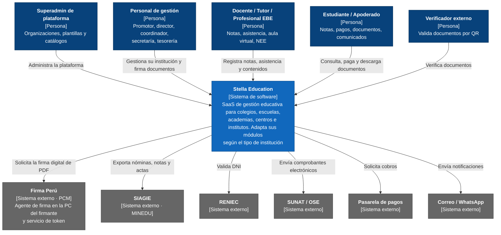

# Nivel 1 · Diagrama de contexto del sistema

> **Proyecto:** Stella Education
> **Modelo:** C4 · Nivel 1 de 4 · **Versión:** 1.0

---

## 1. Objetivo

Mostrar **Stella Education como una sola caja**: quiénes la usan y con qué sistemas externos se comunica. Es la vista de mayor nivel y la primera que se presenta a cualquier persona, técnica o no.

| Aspecto               | Descripción                                                               |
| --------------------- | ------------------------------------------------------------------------- |
| Pregunta que responde | ¿Qué es el sistema, quién lo usa y con quién se integra?                  |
| Audiencia             | Todos: negocio, instituciones clientes, equipo de desarrollo, operaciones |
| Qué **no** muestra    | Tecnologías, servidores, bases de datos ni servicios internos             |
| Siguiente nivel       | `Nivel2-DiagramadeContenedores.md`                                        |

---

## 2. Diagrama

---

## 3. Personas (usuarios)

| Persona                               | Descripción                                            | Qué hace en el sistema                                                                                                        |
| ------------------------------------- | ------------------------------------------------------ | ----------------------------------------------------------------------------------------------------------------------------- |
| **Superadmin de plataforma**          | Equipo que opera Stella Education                      | Da de alta organizaciones, gestiona planes, plantillas por tipo de institución y catálogos MINEDU                             |
| **Personal de gestión**               | Promotor, director, coordinador, secretaría, tesorería | Configura servicios y funciones, matricula, organiza el periodo, cierra cortes, emite y **firma** documentos, gestiona cobros |
| **Docente / Tutor / Profesional EBE** | Personal académico y de apoyo                          | Registra asistencia y calificaciones, publica contenidos, da seguimiento y atiende NEE                                        |
| **Estudiante / Apoderado**            | Usuarios del portal                                    | Consulta notas, asistencia, horario y pagos; paga en línea; descarga sus documentos                                           |
| **Verificador externo**               | Universidad, empleador u otra entidad                  | Escanea el QR de un documento y comprueba su autenticidad (sin cuenta)                                                        |

---

## 4. Sistemas

| Sistema               | Tipo               | Responsabilidad                                                                                                                  | Quién lo construye                                    |
| --------------------- | ------------------ | -------------------------------------------------------------------------------------------------------------------------------- | ----------------------------------------------------- |
| **Stella Education**  | Sistema en alcance | Gestión académica, administrativa y financiera de instituciones educativas de cualquier tipo, con emisión de documentos firmados | El equipo del proyecto                                |
| **Firma Perú**        | Sistema externo    | Firmar digitalmente los PDF con el certificado del usuario (agente local) y emitir el token de autorización                      | PCM – Secretaría de Gobierno y Transformación Digital |
| **SIAGIE**            | Sistema externo    | Registro oficial de estudiantes, notas y actas de la educación básica                                                            | MINEDU                                                |
| **RENIEC**            | Sistema externo    | Validación de identidad por DNI                                                                                                  | RENIEC (vía PIDE o proveedor autorizado)              |
| **SUNAT / OSE**       | Sistema externo    | Validación de comprobantes electrónicos                                                                                          | SUNAT y operador de servicios electrónicos            |
| **Pasarela de pagos** | Sistema externo    | Cobros con tarjeta y billeteras                                                                                                  | Proveedor de pagos                                    |
| **Correo / WhatsApp** | Sistema externo    | Entrega de notificaciones                                                                                                        | Proveedores de mensajería                             |

---

## 5. Relaciones

| Origen           | Destino           | Descripción                                                         | Protocolo                       |
| ---------------- | ----------------- | ------------------------------------------------------------------- | ------------------------------- |
| Personas         | Stella Education  | Usan la plataforma desde el navegador                               | —                               |
| Stella Education | Firma Perú        | Entrega el PDF al agente y recibe el PDF firmado; solicita el token | HTTPS                           |
| Stella Education | SIAGIE            | Exporta información académica                                       | Archivo / HTTPS según modalidad |
| Stella Education | RENIEC            | Consulta DNI                                                        | HTTPS/REST                      |
| Stella Education | SUNAT / OSE       | Envía comprobantes                                                  | HTTPS (REST/SOAP según OSE)     |
| Stella Education | Pasarela de pagos | Solicita cobros y recibe confirmaciones (webhook)                   | HTTPS/REST                      |
| Stella Education | Correo / WhatsApp | Envía mensajes                                                      | HTTPS/REST                      |

> En el nivel 1 no se indica el protocolo entre personas y sistema: eso se detalla en el nivel 2.

---

## 6. Decisiones y supuestos

| #   | Decisión o supuesto                                                    | Motivo                                                            |
| --- | ---------------------------------------------------------------------- | ----------------------------------------------------------------- |
| 1   | Una sola plataforma atiende a todas las instituciones (SaaS)           | Menor costo de operación; las mejoras llegan a todos los clientes |
| 2   | La firma digital se hace con Firma Perú en la computadora del firmante | Validez legal y la plataforma no custodia claves privadas         |
| 3   | Stella Education **no almacena datos de tarjetas**                     | Los procesa la pasarela; se reduce el riesgo                      |
| 4   | Los sistemas externos no se modifican                                  | Son de terceros; la plataforma se adapta a ellos (patrón Adapter) |
| 5   | Las integraciones con el Estado son activables por servicio educativo  | Una academia no necesita SIAGIE                                   |

### Pendientes por definir

| Tema                         | Detalle                                                                      |
| ---------------------------- | ---------------------------------------------------------------------------- |
| Acceso a RENIEC              | Confirmar si será por PIDE (requiere convenio) o por un proveedor autorizado |
| Formato SIAGIE por modalidad | EBA y EBE difieren de EBR; confirmar el formato vigente                      |
| Proveedores                  | Elegir pasarela de pagos, OSE y proveedor de WhatsApp                        |
