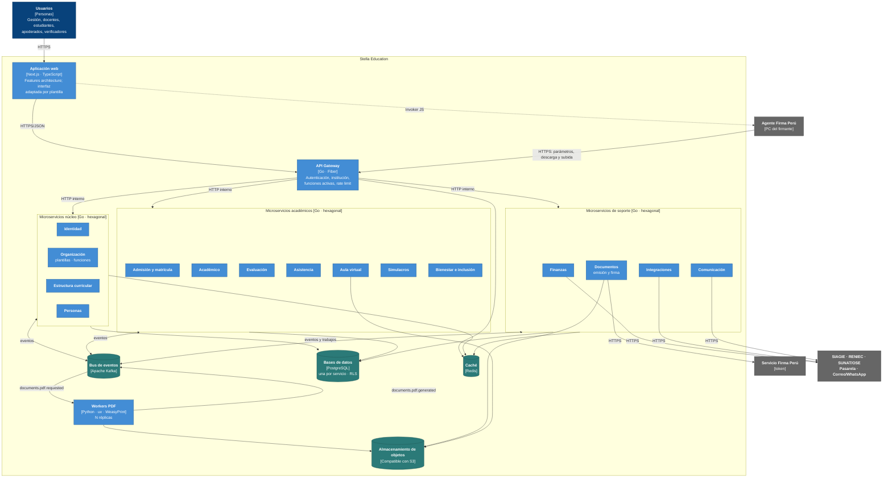

# Nivel 2 · Diagrama de contenedores

> **Proyecto:** Stella Education
> **Modelo:** C4 · Nivel 2 de 4 · **Versión:** 1.0

---

## 1. Objetivo

Abrir la caja «Stella Education» del nivel 1 y mostrar los **contenedores** que la forman: las aplicaciones, servicios y almacenes de datos que se ejecutan por separado, la tecnología de cada uno y cómo se comunican.

| Aspecto               | Descripción                                                                                                                                                               |
| --------------------- | ------------------------------------------------------------------------------------------------------------------------------------------------------------------------- |
| Pregunta que responde | ¿De qué piezas ejecutables se compone el sistema y con qué tecnología?                                                                                                    |
| Audiencia             | Arquitectos, desarrolladores, operaciones                                                                                                                                 |
| Qué es un contenedor  | Algo que se ejecuta o almacena datos de forma independiente: una aplicación web, un microservicio, un worker, una base de datos (no es lo mismo que un contenedor Docker) |
| Nivel anterior        | `Nivel1-DiagramadeContextodelSistema.md`                                                                                                                                  |
| Siguiente nivel       | `Nivel3-Diagrama-de-Componentes.md`                                                                                                                                       |

---

## 2. Diagrama

---

## 3. Contenedores

| Contenedor                    | Tecnología                              | Responsabilidad                                                                                                                                                                          | Datos que maneja                                  |
| ----------------------------- | --------------------------------------- | ---------------------------------------------------------------------------------------------------------------------------------------------------------------------------------------- | ------------------------------------------------- |
| **Aplicación web**            | Next.js (App Router) + TypeScript       | Interfaz para todos los roles y portal de estudiantes y apoderados. Arma el menú y los textos según las funciones activas y las etiquetas del servicio. Integra el invoker de Firma Perú | Ninguno persistente; sesión en cookie segura      |
| **API Gateway**               | Go + Fiber                              | Entrada única. Valida el token, resuelve la institución por subdominio y token, verifica la función activa, aplica límites de peticiones y enruta                                        | Usa Redis (contexto, sesiones revocadas, límites) |
| **Identidad**                 | Go, hexagonal                           | Cuentas, sesiones, 2FA, roles y permisos por institución; emite tokens JWT                                                                                                               | `iam.*`                                           |
| **Organización**              | Go, hexagonal                           | Organizaciones, servicios, sedes, plantillas, funciones activas, etiquetas y suscripción                                                                                                 | `tenant.*`                                        |
| **Estructura curricular**     | Go, hexagonal                           | Catálogo MINEDU y programas propios                                                                                                                                                      | `curriculum.*`, `program.*`                       |
| **Personas**                  | Go, hexagonal                           | Estudiantes, apoderados y personal                                                                                                                                                       | `core.*`                                          |
| **Admisión y matrícula**      | Go, hexagonal                           | Admisión, ubicación, matrícula por sección y curso, traslados, retiros                                                                                                                   | `enrollment.*`                                    |
| **Académico**                 | Go, hexagonal                           | Periodos, cortes, secciones, aulas, carga docente, horarios                                                                                                                              | `academic.*`                                      |
| **Evaluación**                | Go, hexagonal                           | Esquemas de calificación, notas, cierres, situación final, actas                                                                                                                         | `assessment.*`                                    |
| **Asistencia**                | Go, hexagonal                           | Asistencia de estudiantes y personal                                                                                                                                                     | `attendance.*`                                    |
| **Aula virtual**              | Go, hexagonal                           | Recursos, tareas y foros (activable)                                                                                                                                                     | `lms.*` + archivos en S3                          |
| **Simulacros**                | Go, hexagonal                           | Simulacros, corrección y ranking (activable)                                                                                                                                             | `exam.*`                                          |
| **Bienestar e inclusión**     | Go, hexagonal                           | Tutoría, alertas, NEE, POI, PRITE, SAANEE                                                                                                                                                | `wellbeing.*`, `inclusion.*`                      |
| **Finanzas**                  | Go, hexagonal                           | Cronogramas, cobros, becas, caja, comprobantes SUNAT, pagos en línea                                                                                                                     | `finance.*`                                       |
| **Comunicación**              | Go, hexagonal                           | Comunicados, mensajería y notificaciones                                                                                                                                                 | `comms.*`                                         |
| **Documentos**                | Go, hexagonal                           | Solicitudes y lotes de documentos, flujo de firma con Firma Perú, verificación pública                                                                                                   | `documents.*` + PDF en S3                         |
| **Integraciones**             | Go, hexagonal                           | Exportación SIAGIE y consultas RENIEC                                                                                                                                                    | `integration.*`                                   |
| **Workers PDF**               | Python 3.12 + uv, Jinja2, WeasyPrint    | Consumen trabajos de Kafka, generan el PDF con QR y caja de firma, lo suben a S3 y publican el resultado                                                                                 | Sin estado                                        |
| **Bus de eventos**            | Apache Kafka                            | Eventos de dominio y trabajos de PDF                                                                                                                                                     | Mensajes con retención configurable               |
| **Bases de datos**            | PostgreSQL                              | Una base lógica por servicio; RLS por `institution_id`; tabla `outbox` por servicio                                                                                                      | Datos de negocio                                  |
| **Caché**                     | Redis                                   | Contexto del servicio, permisos, sesiones de firma, límites, idempotencia, avance de lotes                                                                                               | Datos temporales                                  |
| **Almacenamiento de objetos** | Compatible con S3 (MinIO en desarrollo) | PDF sin firmar, PDF firmados (versionado y bloqueo de borrado), adjuntos                                                                                                                 | Archivos                                          |

---

## 4. Relaciones

| Origen                                | Destino                   | Descripción                                                                            | Protocolo                      |
| ------------------------------------- | ------------------------- | -------------------------------------------------------------------------------------- | ------------------------------ |
| Usuarios                              | Aplicación web            | Usan la aplicación desde el navegador                                                  | HTTPS                          |
| Aplicación web                        | API Gateway               | Llama a la API (_server actions_ y fetch)                                              | HTTPS/JSON                     |
| Aplicación web                        | Agente Firma Perú         | Inicia la firma en la PC del usuario                                                   | Invoker JavaScript (localhost) |
| Agente Firma Perú                     | API Gateway → Documentos  | Pide parámetros, descarga el PDF y sube el PDF firmado                                 | HTTPS                          |
| API Gateway                           | Microservicios            | Enruta la petición con `X-Institution-Id`, `X-Service-Id`, `X-User-Id` y `traceparent` | HTTP/JSON (red interna)        |
| Microservicios                        | Kafka                     | Publican (vía outbox) y consumen eventos                                               | Protocolo Kafka (TCP)          |
| Documentos                            | Workers PDF               | Encola trabajos de PDF                                                                 | Kafka                          |
| Microservicios                        | PostgreSQL                | Leen y escriben **solo su base**                                                       | SQL sobre TCP                  |
| Gateway y microservicios              | Redis                     | Caché y datos temporales                                                               | RESP (TCP)                     |
| Workers PDF, Documentos, Aula virtual | Almacenamiento de objetos | Guardan y leen archivos                                                                | HTTPS (API S3)                 |
| Documentos                            | Servicio Firma Perú       | Solicita el token de firma                                                             | HTTPS                          |
| Finanzas                              | Pasarela de pagos, OSE    | Cobros y comprobantes                                                                  | HTTPS                          |
| Integraciones                         | SIAGIE, RENIEC            | Exportaciones y consultas                                                              | HTTPS / archivo                |
| Comunicación                          | Correo / WhatsApp         | Envía mensajes                                                                         | HTTPS                          |

---

## 5. Decisiones arquitectónicas reflejadas

| Decisión                                     | Alternativa descartada                                                | Motivo                                                                                                        |
| -------------------------------------------- | --------------------------------------------------------------------- | ------------------------------------------------------------------------------------------------------------- |
| Microservicios por contexto de negocio       | Monolito modular                                                      | Picos de carga distintos por módulo (matrícula, cierre, emisión masiva) y aislamiento de fallas entre módulos |
| API Gateway propio en Go                     | Exponer cada servicio                                                 | Un solo punto para autenticación, institución, funciones activas y límites                                    |
| Kafka como bus de eventos y cola de trabajos | Llamadas HTTP encadenadas; RabbitMQ                                   | Desacopla servicios, conserva el orden por institución (partición por `institution_id`) y permite reprocesar  |
| Workers Python separados para PDF            | Generar PDF dentro de los servicios Go                                | Mejor ecosistema HTML→PDF; escalan solos sin afectar a los servicios                                          |
| Firma en la PC del firmante con Firma Perú   | Firma en el servidor con certificado centralizado                     | La clave privada no sale del firmante; cumple la Ley 27269                                                    |
| Base de datos por servicio con RLS           | Una base compartida por todos los servicios; una base por institución | Independencia entre servicios; aislamiento por institución sin multiplicar bases                              |
| Redis para caché y datos temporales          | Consultar siempre los servicios                                       | El contexto del servicio se lee en cada petición                                                              |
| Almacenamiento de objetos para PDF           | Guardar archivos en PostgreSQL                                        | Archivos grandes, versionado y bloqueo de borrado                                                             |

---

## 6. Seguridad entre contenedores

| Comunicación                         | Medida                                                                                             |
| ------------------------------------ | -------------------------------------------------------------------------------------------------- |
| Navegador → Aplicación web y Gateway | HTTPS; cookies `HttpOnly`, `Secure`, `SameSite`                                                    |
| Aplicación web → Gateway             | Token JWT de acceso de corta duración + token de renovación revocable en Redis                     |
| Gateway → Microservicios             | Red interna; los servicios confían solo en encabezados puestos por el gateway (mTLS en producción) |
| Agente Firma Perú → Gateway          | Sin JWT: protegido por `param_token` de un solo uso y URLs firmadas temporales                     |
| Microservicios → PostgreSQL          | Usuario por servicio sin permisos fuera de su base; RLS con `app.institution_id`                   |
| Microservicios → Kafka               | Autenticación SASL y ACL por tópico (cada servicio publica solo en sus tópicos)                    |
| Microservicios → Externos            | Credenciales de cada proveedor solo en el servicio que lo usa, como secreto del entorno            |
| Almacenamiento de objetos            | Buckets privados; acceso solo con URLs firmadas temporales; bloqueo de borrado para PDF firmados   |
