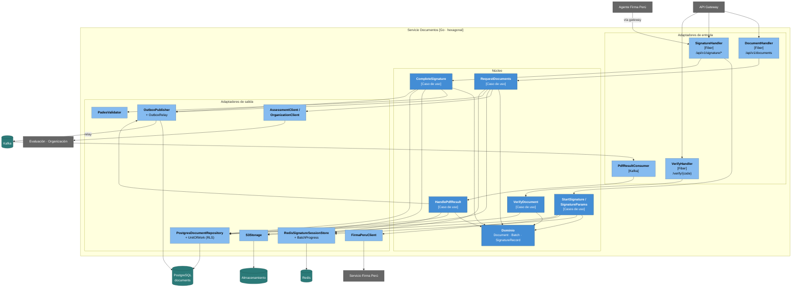
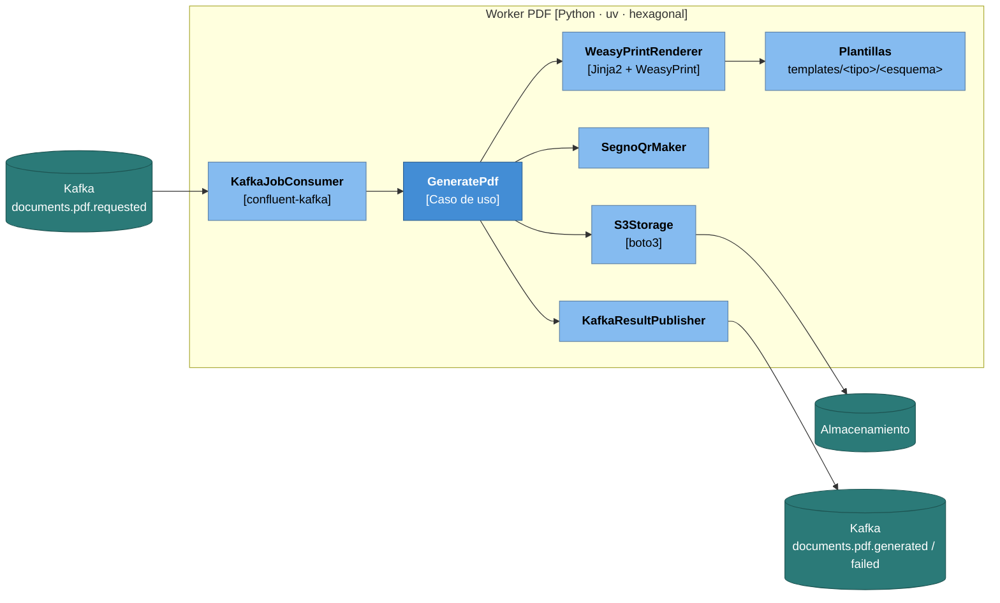

# Nivel 3 · Diagrama de componentes

> **Proyecto:** Stella Education · **Contenedores detallados:** Servicio Documentos y Workers PDF
> **Modelo:** C4 · Nivel 3 de 4 · **Versión:** 1.0

---

## 1. Objetivo

Abrir los contenedores **Documentos** (Go) y **Workers PDF** (Python) del nivel 2 y mostrar sus **componentes**: las piezas de la arquitectura hexagonal, la responsabilidad de cada una y cómo se relacionan con Kafka, PostgreSQL, Redis, el almacenamiento de objetos y Firma Perú.

| Aspecto                    | Descripción                                                                                                                                                         |
| -------------------------- | ------------------------------------------------------------------------------------------------------------------------------------------------------------------- |
| Pregunta que responde      | ¿Cómo se divide un servicio por dentro y qué hace cada parte?                                                                                                       |
| Audiencia                  | Arquitectos y desarrolladores                                                                                                                                       |
| Qué es un componente       | Un grupo de funcionalidades con una responsabilidad clara, accesible mediante una interfaz. Aquí, cada adaptador, puerto y caso de uso de la arquitectura hexagonal |
| Por qué estos contenedores | Concentran el flujo más complejo: generación asíncrona de PDF, firma con Firma Perú y verificación pública. Los demás servicios siguen el mismo esqueleto           |
| Nivel anterior             | `Nivel2-DiagramadeContenedores.md`                                                                                                                                  |
| Siguiente nivel            | `Nivel4-DiagramadeCodigo.md`                                                                                                                                        |

---

## 2. Diagrama: Servicio Documentos

---

## 3. Componentes del Servicio Documentos

| Componente                                     | Tipo                                | Responsabilidad                                                                         | Carpeta en el código                                                                      |
| ---------------------------------------------- | ----------------------------------- | --------------------------------------------------------------------------------------- | ----------------------------------------------------------------------------------------- |
| **DocumentHandler**                            | Adaptador de entrada (HTTP)         | Solicitar documentos, listar, consultar lotes, anular                                   | `adapter/inbound/http/document_handler.go`                                                |
| **SignatureHandler**                           | Adaptador de entrada (HTTP)         | Abrir sesión de firma (usuario) y atender al agente: parámetros, descarga y subida      | `adapter/inbound/http/signature_handler.go`                                               |
| **VerifyHandler**                              | Adaptador de entrada (HTTP público) | Mostrar el estado de un documento por su código de verificación                         | `adapter/inbound/http/verify_handler.go`                                                  |
| **PdfResultConsumer**                          | Adaptador de entrada (Kafka)        | Consumir `documents.pdf.generated` y `documents.pdf.failed`                             | `adapter/inbound/kafka/pdf_result_consumer.go`                                            |
| **RequestDocuments**                           | Caso de uso                         | Crear el lote y los documentos, tomar la foto de los datos y encolar trabajos           | `core/service/request_documents.go`                                                       |
| **HandlePdfResult**                            | Caso de uso                         | Registrar el PDF generado o el error, y actualizar el avance del lote                   | `core/service/handle_pdf_result.go`                                                       |
| **StartSignature / SignatureParams**           | Casos de uso                        | Crear la sesión de firma y entregar al agente los parámetros con el token de Firma Perú | `core/service/start_signature.go`, `signature_params.go`                                  |
| **CompleteSignature**                          | Caso de uso                         | Validar el PDF firmado, guardarlo como versión inmutable y publicar el evento           | `core/service/complete_signature.go`                                                      |
| **VerifyDocument**                             | Caso de uso                         | Devolver autenticidad, estado, firmante y fecha (sin datos sensibles)                   | `core/service/verify_document.go`                                                         |
| **Dominio**                                    | Entidades y reglas                  | Estados del documento, lote, registro de firma                                          | `core/domain/`                                                                            |
| **PostgresDocumentRepository**                 | Adaptador de salida                 | Persistencia con RLS por institución                                                    | `adapter/outbound/postgres/`                                                              |
| **OutboxPublisher + OutboxRelay**              | Adaptador de salida                 | Guardar eventos en `outbox` y enviarlos a Kafka                                         | `adapter/outbound/postgres/outbox_publisher.go`, `adapter/outbound/kafka/outbox_relay.go` |
| **S3Storage**                                  | Adaptador de salida                 | Guardar PDF y generar URLs firmadas                                                     | `adapter/outbound/storage/`                                                               |
| **RedisSignatureSessionStore + BatchProgress** | Adaptador de salida                 | Sesiones de firma de un solo uso; contador de avance de lotes                           | `adapter/outbound/redisclient/`                                                           |
| **FirmaPeruClient**                            | Adaptador de salida                 | Obtener el token de Firma Perú y armar los parámetros que espera el agente              | `adapter/outbound/firmaperu/`                                                             |
| **PadesValidator**                             | Adaptador de salida                 | Comprobar que el PDF tiene una firma PAdES válida y extraer el certificado del firmante | `adapter/outbound/pades/`                                                                 |
| **AssessmentClient / OrganizationClient**      | Adaptador de salida                 | Obtener datos de notas y el contexto del servicio (funciones, etiquetas, plantilla)     | `adapter/outbound/services/`                                                              |

---

## 4. Diagrama: Workers PDF

## 5. Componentes del Worker PDF

| Componente               | Tipo                 | Responsabilidad                                                                                                            | Carpeta en el código              |
| ------------------------ | -------------------- | -------------------------------------------------------------------------------------------------------------------------- | --------------------------------- |
| **KafkaJobConsumer**     | Adaptador de entrada | Leer trabajos del grupo `pdf-workers`, deserializar y validar con el esquema `v1`; confirmar el _offset_ al terminar       | `adapters/kafka_consumer.py`      |
| **GeneratePdf**          | Caso de uso          | Armar el contexto (datos + etiquetas + QR), renderizar, guardar y publicar el resultado                                    | `application/generate_pdf.py`     |
| **WeasyPrintRenderer**   | Adaptador de salida  | Convertir la plantilla HTML/CSS en PDF                                                                                     | `adapters/weasyprint_renderer.py` |
| **Plantillas**           | Recursos             | Una carpeta por tipo de documento y esquema de calificación, con caja de firma reservada                                   | `templates/`                      |
| **SegnoQrMaker**         | Adaptador de salida  | Generar el QR con la URL de verificación                                                                                   | `adapters/segno_qr.py`            |
| **S3Storage**            | Adaptador de salida  | Subir el PDF a la ruta `institution/<id>/documents/<doc>/v<n>.pdf`                                                         | `adapters/s3_storage.py`          |
| **KafkaResultPublisher** | Adaptador de salida  | Publicar `documents.pdf.generated.v1` (ruta, sha256, páginas, coordenadas de la caja de firma) o `documents.pdf.failed.v1` | `adapters/kafka_publisher.py`     |

---

## 6. Relaciones con contenedores y sistemas externos

| Componente                 | Destino                        | Descripción                                            | Protocolo           | Patrón aplicado           |
| -------------------------- | ------------------------------ | ------------------------------------------------------ | ------------------- | ------------------------- |
| PostgresDocumentRepository | PostgreSQL (`documents`)       | Lee y escribe **solo sus propias tablas**, con RLS     | SQL                 | Repository + Unit of Work |
| OutboxRelay                | Kafka                          | Publica eventos guardados en `outbox`                  | Kafka               | Transactional Outbox      |
| PdfResultConsumer          | Kafka                          | Consume resultados de los workers                      | Kafka               | Idempotent Consumer       |
| KafkaJobConsumer (worker)  | Kafka                          | Consume trabajos en grupo                              | Kafka               | Competing Consumers       |
| S3Storage                  | Almacenamiento                 | Guarda PDF y genera URLs firmadas                      | HTTPS (API S3)      | Adapter                   |
| RedisSignatureSessionStore | Redis                          | Sesiones de firma con TTL                              | RESP                | —                         |
| FirmaPeruClient            | Servicio Firma Perú            | Obtiene el token de firma                              | HTTPS               | Adapter                   |
| SignatureHandler           | Agente Firma Perú              | Entrega parámetros y PDF; recibe el PDF firmado        | HTTPS (vía gateway) | Adapter                   |
| OrganizationClient         | Organización (con caché Redis) | Contexto del servicio: funciones, etiquetas, plantilla | HTTP interno        | Cache-Aside + Decorator   |

---

## 7. Endpoints del Servicio Documentos

| Método | Ruta (en el gateway)                        | Quién la llama      | Descripción                             |
| ------ | ------------------------------------------- | ------------------- | --------------------------------------- |
| `POST` | `/api/v1/documents/requests`                | Aplicación web      | Solicitar documentos (uno o un lote)    |
| `GET`  | `/api/v1/documents/batches/{id}`            | Aplicación web      | Avance del lote                         |
| `GET`  | `/api/v1/documents`                         | Aplicación web      | Listar documentos con filtros           |
| `POST` | `/api/v1/documents/{id}/signature-sessions` | Aplicación web      | Abrir sesión de firma                   |
| `POST` | `/api/v1/documents/{id}/void`               | Aplicación web      | Anular y emitir nueva versión           |
| `POST` | `/api/v1/signature/params`                  | Agente Firma Perú   | Parámetros de firma (con `param_token`) |
| `GET`  | `/api/v1/signature/sessions/{sid}/source`   | Agente Firma Perú   | Descargar el PDF a firmar               |
| `POST` | `/api/v1/signature/sessions/{sid}/signed`   | Agente Firma Perú   | Subir el PDF firmado                    |
| `GET`  | `/verify/{code}`                            | Verificador externo | Verificación pública                    |

---

## 8. Reglas de los microservicios

| #   | Regla                                                                                | Motivo                                                      |
| --- | ------------------------------------------------------------------------------------ | ----------------------------------------------------------- |
| 1   | Cada servicio se despliega por separado y tiene el mismo esqueleto hexagonal         | Independencia y uniformidad                                 |
| 2   | Un servicio usa a otro solo por su API REST interna o por sus eventos                | Evita que un cambio interno rompa a los demás               |
| 3   | Un servicio no lee ni escribe las tablas de otro                                     | Cada servicio es dueño de sus datos                         |
| 4   | El worker no accede a bases de datos; todo llega en el trabajo                       | Escala sin límites de conexiones y sin acoplarse a esquemas |
| 5   | Los endpoints que llama el agente Firma Perú no usan JWT, sino tokens de un solo uso | El agente no tiene la sesión del navegador                  |
