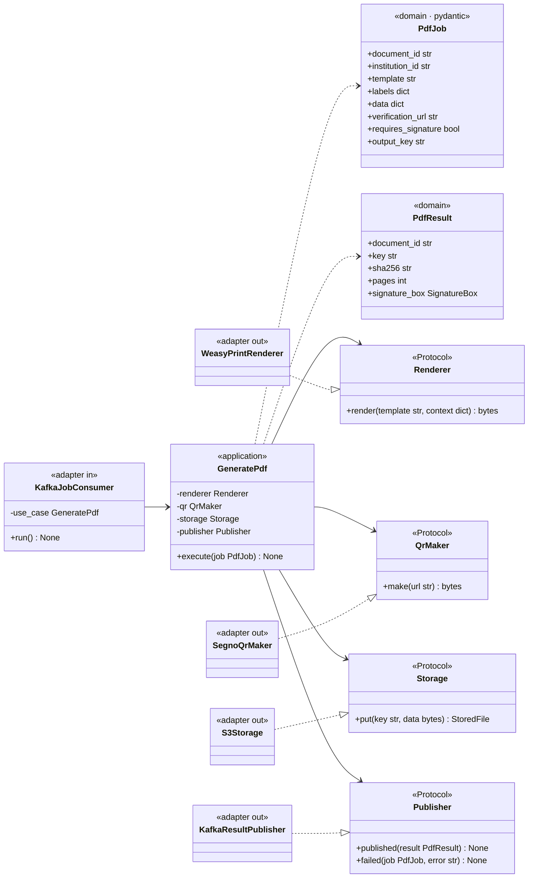
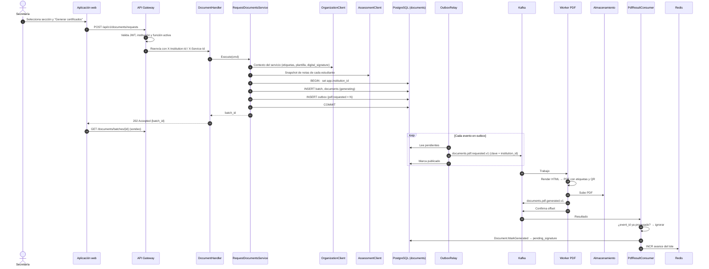
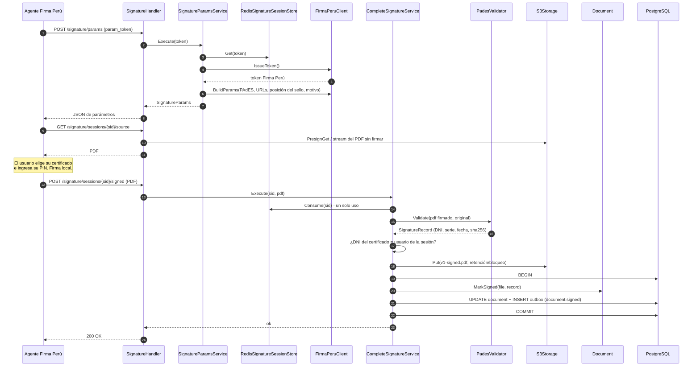

# Nivel 4 · Diagrama de código

> **Proyecto:** Stella Education · **Componentes detallados:** emisión y firma de documentos (Servicio Documentos + Worker PDF)
> **Modelo:** C4 · Nivel 4 de 4 · **Notación:** UML · **Versión:** 1.0

---

## 1. Objetivo

Mostrar **cómo está organizado el código** de los componentes del nivel 3: sus tipos, interfaces y la forma en que colaboran. Se detallan los flujos **Solicitar certificados** y **Firmar con Firma Perú**.

| Aspecto                 | Descripción                                                                                                                                          |
| ----------------------- | ---------------------------------------------------------------------------------------------------------------------------------------------------- |
| Pregunta que responde   | ¿Qué tipos existen dentro de un servicio y cómo se relacionan?                                                                                       |
| Audiencia               | Desarrolladores                                                                                                                                      |
| Notación                | UML (diagrama de clases y diagramas de secuencia). En Go, las "clases" son `struct` con métodos e `interface`                                        |
| Por qué solo este flujo | El nivel 4 es opcional en C4 y se dibuja solo para lo más complejo. La emisión y firma de documentos cruza Go, Kafka, Python, S3, Redis y Firma Perú |
| Nivel anterior          | `Nivel3-Diagrama-de-Componentes.md`                                                                                                                  |

---

## 2. Diagrama de clases: Servicio Documentos (Go)

```mermaid
classDiagram
    direction LR

    %% ---------- Adaptadores de entrada ----------
    class DocumentHandler {
        <<adapter in · http>>
        -request port.RequestDocumentsUseCase
        +PostRequests(c *fiber.Ctx) error
    }
    class SignatureHandler {
        <<adapter in · http>>
        -start port.StartSignatureUseCase
        -params port.SignatureParamsUseCase
        -complete port.CompleteSignatureUseCase
        +PostSession(c) error
        +PostParams(c) error
        +GetSource(c) error
        +PostSigned(c) error
    }
    class PdfResultConsumer {
        <<adapter in · kafka>>
        -handle port.HandlePdfResultUseCase
        +Run(ctx) error
    }

    %% ---------- Puertos de entrada ----------
    class RequestDocumentsUseCase {
        <<interface>>
        +Execute(ctx, RequestDocumentsCommand) (string, error)
    }
    class CompleteSignatureUseCase {
        <<interface>>
        +Execute(ctx, sessionID string, pdf io.Reader) error
    }

    %% ---------- Servicios de aplicación ----------
    class RequestDocumentsService {
        <<application>>
        -repo DocumentRepository
        -data DocumentDataSource
        -ctx ServiceContext
        -events EventPublisher
        -tx UnitOfWork
        +Execute(ctx, cmd) (string, error)
    }
    class CompleteSignatureService {
        <<application>>
        -sessions SignatureSessionStore
        -validator SignatureValidator
        -storage FileStorage
        -repo DocumentRepository
        -events EventPublisher
        -tx UnitOfWork
        +Execute(ctx, sessionID, pdf) error
    }

    %% ---------- Dominio ----------
    class Document {
        <<entity>>
        +ID string
        +InstitutionID string
        +ServiceID string
        +Type DocumentType
        +Status DocumentStatus
        +RequiresSignature bool
        +VerificationCode string
        +Version int
        +StartGenerating() error
        +MarkGenerated(StoredFile) error
        +MarkFailed(reason string) error
        +MarkSigned(StoredFile, SignatureRecord) error
        +Void(reason string) (Document, error)
    }
    class Batch {
        <<entity>>
        +ID string
        +Total int
        +Done int
        +Failed int
    }
    class DocumentStatus {
        <<enumeration>>
        requested
        generating
        pending_signature
        signed
        issued
        failed
        voided
    }
    class SignatureRecord {
        <<value object>>
        +SignerDNI string
        +SignerName string
        +CertificateSerial string
        +SignedAt time.Time
        +SHA256 string
    }
    class StoredFile {
        <<value object>>
        +Key string
        +SHA256 string
        +Size int64
    }

    %% ---------- Puertos de salida ----------
    class DocumentRepository {
        <<interface>>
        +Save(ctx, *Document) error
        +SaveBatch(ctx, *Batch) error
        +ByID(ctx, id string) (*Document, error)
    }
    class EventPublisher {
        <<interface>>
        +Publish(ctx, Event) error
    }
    class FileStorage {
        <<interface>>
        +Put(ctx, key, io.Reader, PutOptions) (StoredFile, error)
        +PresignGet(ctx, key, ttl) (string, error)
    }
    class SignatureProvider {
        <<interface>>
        +IssueToken(ctx) (string, error)
        +BuildParams(ctx, SignatureParamsInput) (SignatureParams, error)
    }
    class SignatureValidator {
        <<interface>>
        +Validate(ctx, signed io.Reader, original StoredFile) (SignatureRecord, error)
    }
    class SignatureSessionStore {
        <<interface>>
        +Create(ctx, SignatureSession) (token string, error)
        +Consume(ctx, sessionID string) (SignatureSession, error)
    }

    %% ---------- Adaptadores de salida ----------
    class PostgresDocumentRepository {
        <<adapter out · postgres>>
    }
    class OutboxPublisher {
        <<adapter out · postgres>>
    }
    class S3Storage {
        <<adapter out · s3>>
    }
    class FirmaPeruClient {
        <<adapter out · https>>
        -clientID string
        -clientSecret string
        -tokenURL string
    }
    class PadesValidator {
        <<adapter out>>
    }
    class RedisSignatureSessionStore {
        <<adapter out · redis>>
    }

    DocumentHandler --> RequestDocumentsUseCase
    SignatureHandler --> CompleteSignatureUseCase
    PdfResultConsumer ..> Document

    RequestDocumentsService ..|> RequestDocumentsUseCase
    CompleteSignatureService ..|> CompleteSignatureUseCase

    RequestDocumentsService --> DocumentRepository
    RequestDocumentsService --> EventPublisher
    CompleteSignatureService --> SignatureSessionStore
    CompleteSignatureService --> SignatureValidator
    CompleteSignatureService --> FileStorage
    CompleteSignatureService --> DocumentRepository
    CompleteSignatureService --> EventPublisher

    RequestDocumentsService ..> Document : crea
    CompleteSignatureService ..> Document : MarkSigned
    Batch "1" o-- "*" Document
    Document --> DocumentStatus
    Document --> SignatureRecord
    Document --> StoredFile

    PostgresDocumentRepository ..|> DocumentRepository
    OutboxPublisher ..|> EventPublisher
    S3Storage ..|> FileStorage
    FirmaPeruClient ..|> SignatureProvider
    PadesValidator ..|> SignatureValidator
    RedisSignatureSessionStore ..|> SignatureSessionStore
```

### 2.1 Capas de la arquitectura hexagonal

| Capa                       | Contiene                                                          | Regla                                                                        |
| -------------------------- | ----------------------------------------------------------------- | ---------------------------------------------------------------------------- |
| **Adaptadores de entrada** | _Handlers_ HTTP (Fiber) y consumidores Kafka                      | Traducen la petición o el mensaje a un comando y llaman al puerto de entrada |
| **Puertos de entrada**     | Interfaces de casos de uso                                        | Definen **qué** puede pedir el exterior                                      |
| **Aplicación**             | Servicios que implementan los casos de uso                        | Coordinan los pasos; no conocen la tecnología                                |
| **Dominio**                | Entidades, objetos de valor, enumeraciones                        | Contienen las reglas; no importan nada de las otras capas                    |
| **Puertos de salida**      | Interfaces de repositorio, publicador, almacenamiento, Firma Perú | Definen **qué** necesita el núcleo                                           |
| **Adaptadores de salida**  | PostgreSQL, Kafka/outbox, Redis, S3, Firma Perú, validador PAdES  | Implementan los puertos con una tecnología concreta                          |

> **Regla de dependencia:** las flechas apuntan hacia el núcleo. Los adaptadores implementan interfaces del núcleo (línea punteada con triángulo); el núcleo nunca conoce a los adaptadores.

### 2.2 Tipos principales

| Tipo                         | Clase UML       | Capa                 | Responsabilidad                                                                       |
| ---------------------------- | --------------- | -------------------- | ------------------------------------------------------------------------------------- |
| `DocumentHandler`            | Controlador     | Adaptador de entrada | Recibe `POST /api/v1/documents/requests` y responde `202 Accepted` con el `batch_id`  |
| `SignatureHandler`           | Controlador     | Adaptador de entrada | Atiende la sesión de firma del usuario y las llamadas del agente                      |
| `PdfResultConsumer`          | Consumidor      | Adaptador de entrada | Traduce el evento del worker a `HandlePdfResult`                                      |
| `RequestDocumentsService`    | Caso de uso     | Aplicación           | Crea lote y documentos; encola trabajos vía outbox                                    |
| `CompleteSignatureService`   | Caso de uso     | Aplicación           | Consume la sesión, valida la firma, guarda el PDF firmado y publica `document.signed` |
| `Document`                   | Entidad         | Dominio              | Controla las transiciones de estado e impide modificar un documento firmado           |
| `Batch`                      | Entidad         | Dominio              | Cuenta el avance y los errores del lote                                               |
| `SignatureRecord`            | Objeto de valor | Dominio              | Firmante, certificado, fecha y hash del PDF firmado                                   |
| `SignatureProvider`          | Interfaz        | Puerto de salida     | Token y parámetros de Firma Perú                                                      |
| `SignatureValidator`         | Interfaz        | Puerto de salida     | Validar el PDF firmado contra el original                                             |
| `FirmaPeruClient`            | Adaptador       | Adaptador de salida  | Implementa `SignatureProvider` con la API de Firma Perú                               |
| `PostgresDocumentRepository` | Repositorio     | Adaptador de salida  | Implementa `DocumentRepository` con PostgreSQL y RLS                                  |
| `OutboxPublisher`            | Publicador      | Adaptador de salida  | Implementa `EventPublisher` escribiendo en la tabla `outbox`                          |

---

## 3. Diagrama de clases: Worker PDF (Python)

---

## 4. Diagrama de secuencia: solicitar certificados de una sección

| Paso  | Qué ocurre                                                                          | Clase responsable                               |
| ----- | ----------------------------------------------------------------------------------- | ----------------------------------------------- |
| 1-4   | El gateway autentica, resuelve la institución y verifica que la función esté activa | Gateway                                         |
| 5-6   | El handler arma el comando y llama al caso de uso                                   | `DocumentHandler`                               |
| 7-8   | Se lee el contexto del servicio y la foto de los datos                              | `RequestDocumentsService`                       |
| 9-12  | Documentos y eventos se guardan en una sola transacción con RLS                     | `PostgresDocumentRepository`, `OutboxPublisher` |
| 13-14 | Se responde de inmediato; la generación es asíncrona                                | `DocumentHandler`                               |
| 16-18 | El relay publica los trabajos en Kafka                                              | `OutboxRelay`                                   |
| 19-23 | Un worker libre genera y sube el PDF                                                | `GeneratePdf`                                   |
| 24-27 | Se registra el resultado de forma idempotente y se actualiza el avance              | `PdfResultConsumer`, `Document`                 |

---

## 5. Diagrama de secuencia: firmar con Firma Perú (código)

| Regla verificada en el código                                                          | Dónde                                             |
| -------------------------------------------------------------------------------------- | ------------------------------------------------- |
| La sesión solo se puede usar una vez y vence en minutos                                | `RedisSignatureSessionStore.Consume`              |
| El documento debe estar en `pending_signature`                                         | `Document.MarkSigned`                             |
| El firmante del certificado es el usuario que abrió la sesión y tiene permiso de firma | `CompleteSignatureService`                        |
| El PDF firmado contiene el mismo contenido que el original más la firma                | `PadesValidator.Validate`                         |
| El PDF firmado se guarda con bloqueo de borrado y nunca se sobrescribe                 | `S3Storage.Put` con `PutOptions{Immutable: true}` |
| El evento se publica solo si la transacción se confirma                                | `OutboxPublisher`                                 |

---

## 6. Cómo se prueba este código

| Tipo de prueba          | Qué se prueba                                                                     | Con qué                                                          |
| ----------------------- | --------------------------------------------------------------------------------- | ---------------------------------------------------------------- |
| Unitaria de dominio     | Transiciones de `Document` (por ejemplo, no se puede firmar un documento anulado) | `go test`, sin dependencias                                      |
| Unitaria de caso de uso | `RequestDocumentsService`, `CompleteSignatureService`                             | Adaptadores en memoria que implementan los puertos               |
| De contrato             | Esquemas de eventos `documents.pdf.*.v1` entre Go y Python                        | JSON Schema en `contracts/events/`                               |
| De integración          | Repositorio con RLS, outbox y relay                                               | PostgreSQL y Kafka en contenedores (Testcontainers)              |
| Del worker              | Render de cada plantilla y esquema de calificación                                | `uv run pytest` con PDF de referencia                            |
| De extremo a extremo    | Solicitar → generar → firmar → verificar                                          | Entorno de desarrollo con un certificado de prueba de Firma Perú |
